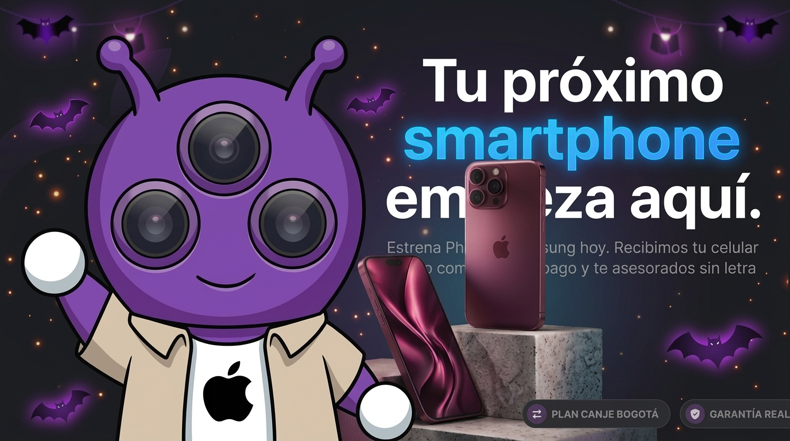

# 👋 Hola, soy Kevin Camilo

### 💻 Desarrollador de Software Junior | Backend

Estudiante de Ingeniería de Sistemas y Análisis y Desarrollo de Software,
orientado al desarrollo backend y la automatización de procesos.

🐍 Python · ☕ Java · 🌐 Django · 🗄️ SQL · 🐙 Git/GitHub

## 🛠️ Tecnologías

### Lenguajes

### Backend y bases de datos

### Herramientas

## Proyectos Propios 
### JL Phone - Tienda de celulares 
Sitio Web Comercial Responsive desarrollado para un cliente con una necesidad real, enfocado para mostrar un  catalogo de productos actualizado con botón que lleva a whatsapp del empresario.

🌐 [Visitar sitio web](https://jlphone.tech/)

### Stack tecnológico
- **Frontend:**
- 
    
    
    
- **Estilos:**
    *CSS personalizado*
- **Build Tool:**
  - 
- **Backend as a Service (BaaS):**
  -  Supabase *(Base de datos y autenticación)*

- **Despliegue y CI/CD:**
  -  *GitHub Pages & GitHub Actions*

## 🎯 Objetivo
Seguir desarrollándome como profesional en el área de software,
especialmente en Backend, y participar en proyectos donde pueda
aplicar mis conocimientos y continuar aprendiendo.

## 📚 Actualmente aprendiendo

- 🌐 Desarrollo de APIs REST
- 🔐 Autenticación y seguridad en aplicaciones web
- 🧪 Testing
- ☁️ Fundamentos de Cloud

## 📫 Contacto

📧 **Email:** camilosbchapa@gmail.com 
🐙 **GitHub:** [Camilosb101](https://github.com/Camilosb101)
